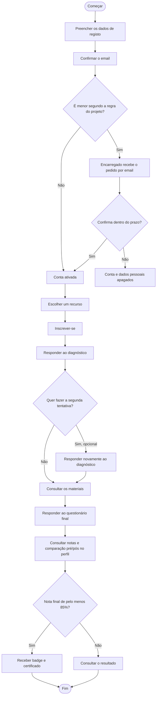

# Personas e percurso do aluno — A015

Estas personas ajudam a pensar no uso da plataforma, mas são apenas perfis de referência construídos a partir dos requisitos do projeto. Não foram feitas entrevistas com alunos ou encarregados de educação.

## Personas

**Aluno do 3.º ciclo ou do ensino secundário.** Quer encontrar um recurso de saúde, completar as atividades e perceber o que aprendeu. Precisa de saber se a conta está ativa, qual é o passo seguinte e onde consultar as notas e o certificado. A plataforma deve estar disponível em português ou inglês, conforme o idioma escolhido.

**Professor.** Usa a plataforma no contexto educativo e procura recursos de saúde que possa consultar com os alunos. Precisa de encontrar os conteúdos com facilidade e perceber que atividades fazem parte de cada recurso. O enunciado identifica o professor como utilizador da ALFAS, mas não especifica permissões ou tarefas próprias deste perfil; esta descrição deve ser confirmada no estudo UI/UX.

**Profissional de saúde.** Usa a ALFAS no contexto da literacia em saúde e precisa de consultar os recursos disponibilizados na plataforma. O enunciado não define se este perfil também cria ou gere conteúdos, por isso essa responsabilidade não é assumida nesta persona e deve ser esclarecida antes de orientar funcionalidades para ela.

O encarregado de educação participa no registo quando o aluno é menor, segundo a regra do projeto. Recebe por email o pedido de consentimento e usa o link enviado para o confirmar. A conta do aluno só é ativada depois dessa confirmação; é um interveniente no percurso, não uma das três personas pedidas para a A015.

## Percurso do aluno

O diagrama mostra o caminho desde o registo até à consulta do resultado. O pedido de consentimento parental só aparece no caso dos menores, conforme o requisito do projeto.

O diagnóstico permite até duas tentativas, mas a comparação pré/pós usa a primeira. O questionário final permite uma tentativa. O badge e o certificado são atribuídos quando a nota final é igual ou superior a 85%; abaixo desse valor, o aluno continua a poder consultar o resultado.

Se o consentimento parental for revogado depois da ativação, a conta fica bloqueada. Um novo consentimento nos 30 dias seguintes permite reativá-la; sem novo consentimento nesse prazo, a conta e os dados pessoais são apagados. Este caso não está no caminho principal do diagrama, que se foca no percurso até ao resultado.

## Referências

- Requisitos RF01–RF10 em [`requisitos-furps.md`](requisitos-furps.md).
- Registo e consentimento em [`../diagramas/UC_Registar_Utilizador.mermaid`](../diagramas/UC_Registar_Utilizador.mermaid).
- Regras de tentativas e certificado nas notas P2 e P4 do [MRD v1.1](../diagramas/modelos-dados.drawio).
- Regras de privacidade no [mapa RGPD](mapa-rgpd.md).
